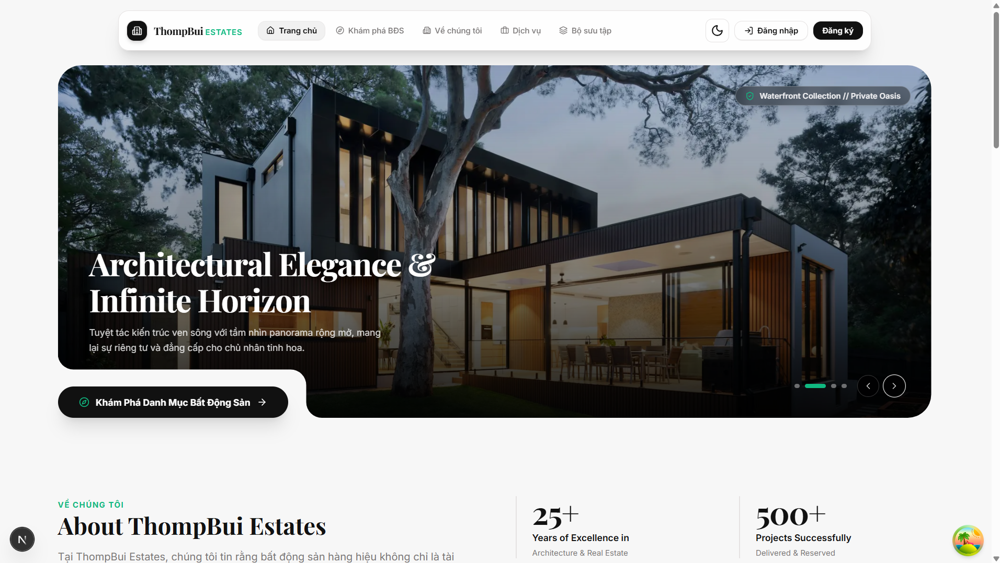
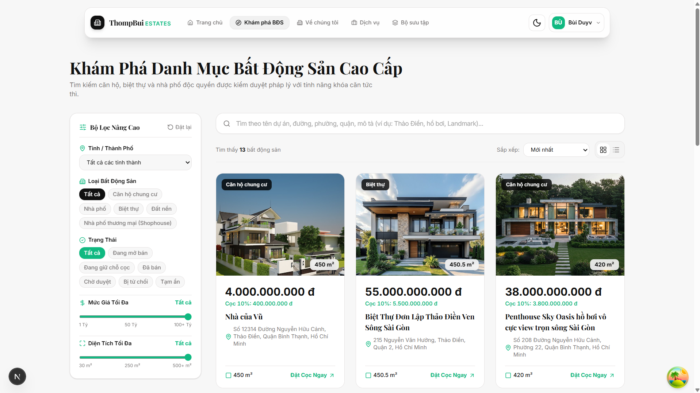
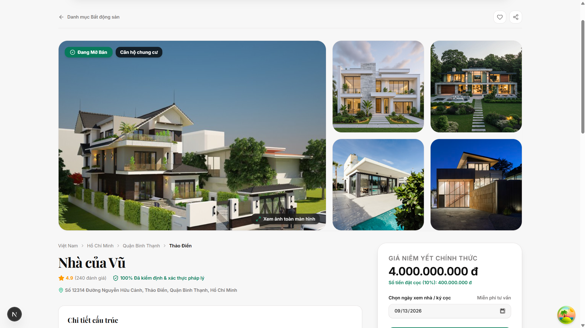
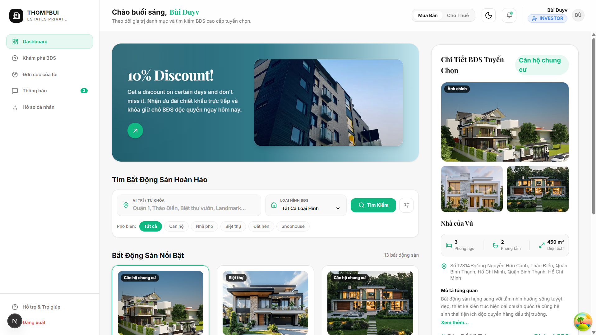
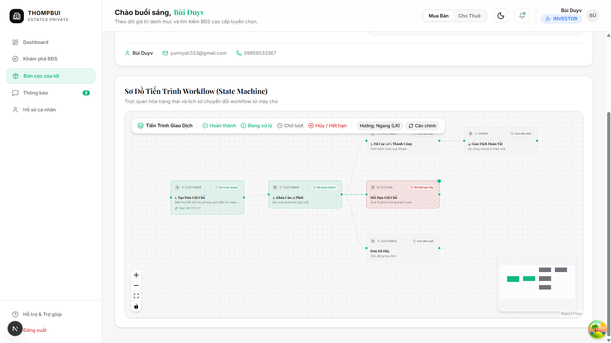

# 🏢 Real Estate Enterprise Platform — Backend Service


Hệ thống Backend Nền tảng Bất Động Sản Doanh Nghiệp (**ThompBui Estates Platform**) được kiến trúc theo mô hình **Phân tầng chuẩn mực (Layered Architecture / MVC - Package-by-Layer)** trên nền tảng **Java 21** và **Spring Boot 4.1.0**. Hệ thống tích hợp cơ chế kiểm soát đồng thời 2 tầng (**Redisson Distributed Lock** + **JPA Optimistic Locking**), công cụ quy trình đặt cọc tùy biến (**Custom Workflow Engine**), thanh toán **Stripe Gateway** với kiểm soát tính lũy thừa (Strict Idempotency), bus sự kiện bất đồng bộ trong bộ nhớ (**Spring In-Memory Event Bus**), lưu trữ tệp tin đám mây **MinIO**, cùng hệ thống giám sát và chẩn đoán sức khỏe hệ thống thời gian thực (**Real-time System Health & JVM Diagnostics**).

---

## 📸 Hình Ảnh Giao Diện Thực Tế (Web Platform Showcase)

### 1. 🏠 Trang Chủ Nền Tảng & Khám Phá Danh Mục Bất Động Sản
<p align="center">
  
  
</p>
<p align="center">
  <em>(Trái: 1.png) Trang chủ & Nhận diện thương hiệu ThompBui Estates &bull; (Phải: 2.png) Khám phá danh mục BĐS & Bộ lọc đa chiều (Giá, Vị trí, Diện tích)</em>
</p>

### 2. 🏡 Chi Tiết Bất Động Sản & Cổng Thông Tin Nhà Đầu Tư (Investor Portal)
<p align="center">
  
  
</p>
<p align="center">
  <em>(Trái: 3.png) Chi tiết BĐS, thư viện hình ảnh, pháp lý & mức cọc 10% &bull; (Phải: 4.png) Cổng nhà đầu tư (Investor Portal) cá nhân hóa với BĐS tuyển chọn</em>
</p>

### 3. ⚡ Trực Quan Hóa Tiến Trình Workflow Đặt Cọc (State Machine & Concurrency)
<p align="center">
  
</p>
<p align="center">
  <em>(5.png) Sơ đồ State Machine trực quan hóa vòng đời giữ chỗ: Khóa căn 15 phút (Redisson Distributed Lock) ➔ Thanh toán cọc qua Stripe ➔ Hoàn tất hợp đồng</em>
</p>

---

## 🚀 Các Tính Năng & Điểm Sáng Kỹ Thuật (Architectural Highlights)

### 1. 🏛️ Kiến Trúc Phân Tầng Trực Quan (Layered Architecture / MVC)
Toàn bộ mã nguồn được tổ chức theo từng tầng trách nhiệm rõ ràng (Package-by-Layer), giúp nhà phát triển dễ dàng định vị, kiểm soát và phát triển tính năng:
- **`controller/`**: Điểm tiếp nhận request RESTful API (Auth, Property, Reservation, Payment, SystemHealth, Dashboard).
- **`service/`**: Tầng nghiệp vụ xử lý logic cốt lõi (xử lý đặt cọc, thanh toán Stripe, email template, token cache).
- **`repository/`**: Tầng giao tiếp cơ sở dữ liệu với Spring Data JPA & JPA Specification dynamic filtering.
- **`entity/`**: Các thực thể ánh xạ CSDL PostgreSQL (User, Property, Reservation, Payment, WorkflowHistory, Role, Permission).
- **`dto/`**: Các Java record bất biến (Immutable Records) phân định rõ `request/` và `response/`.
- **`event/`**: Tầng sự kiện nội bộ Spring In-Memory Event Bus (`EmailVerificationEvent`, `DepositPaidEvent`) và các Listener `@Async`.
- **`workflow/`**: Động cơ quy trình chuyển đổi trạng thái State Machine tùy biến bằng Spring AOP & SpEL (`@WorkflowEngine`).
- **`security/`**: Cơ chế bảo mật Stateless JWT, CustomUserDetails, phân quyền phương thức RBAC.
- **`config/`**: Toàn bộ cấu hình hệ thống (Async ThreadPool, Redis, Redisson, OpenAPI, MinIO, Security, Locale i18n).
- **`scheduler/`**: Tác vụ nền định kỳ quét và giải phóng các đơn đặt cọc quá hạn 15 phút.
- **`common/` & `exception/`**: Cấu trúc phản hồi API đồng nhất (`ApiResponse<T>`) và bắt lỗi toàn cục (`GlobalExceptionHandler`).

### 2. 🔒 Kiểm Soát Đồng Thời 2 Tầng (Two-Tier Concurrency Control)
Ngăn chặn triệt để hiện tượng **Double Booking** (bán trùng căn) và **Lost Update** khi nhiều khách hàng cùng bấm đặt cọc 1 bất động sản tại cùng một thời điểm:
- **Tầng 1 (Service Layer — Redisson Distributed Lock)**: Áp dụng khóa phân tán theo ID bất động sản với cơ chế thử lại có giới hạn thời gian (Fair Lock timeout). Đảm bảo chỉ 1 request duy nhất được phép khởi tạo đơn đặt cọc và chuyển trạng thái căn hộ sang giữ chỗ 15 phút.
- **Tầng 2 (Database Layer — JPA Optimistic Locking `@Version`)**: Quản lý phiên bản dữ liệu tại PostgreSQL, tự động phát hiện xung đột và rollback giao dịch nếu có sự thay đổi trạng thái đồng thời ngoài dự tính.

### 3. ⚙️ Động Cơ Quy Trình Đặt Cọc Tùy Biến (Custom Event-Driven Workflow Engine)
- Xây dựng Workflow Engine chuyên biệt bằng **Spring AOP** và **Spring Expression Language (SpEL)** qua annotation `@WorkflowEngine`.
- Kiểm soát chuyển dịch trạng thái nghiêm ngặt theo State Machine:
  $$\text{PENDING} \longrightarrow \text{DEPOSIT\_PAID} \longrightarrow \text{COMPLETED} \quad \text{hoặc} \quad \{\text{CANCELLED}, \text{EXPIRED}\}$$
- **Cô lập lịch sử kiểm toán (Audit Trail Isolation)**: Áp dụng `@Transactional(propagation = Propagation.REQUIRES_NEW)` khi ghi nhật ký lịch sử `workflow_histories`. Đảm bảo mọi bước chuyển trạng thái (kể cả thất bại do nghiệp vụ) đều được lưu vết vĩnh viễn mà không bị rollback theo giao dịch chính.
- **Scheduler giải phóng căn tự động**: Định kỳ quét các đơn đặt cọc quá hạn 15 phút chưa thanh toán cọc để đưa trạng thái căn hộ về `AVAILABLE` và cập nhật đơn cọc sang `EXPIRED`.

### 4. ⚡ Bus Sự Kiện Bất Đồng Bộ Trong Bộ Nhớ (Spring In-Memory Event Bus)
- Thay thế hoàn toàn các broker cồng kềnh bằng kiến trúc sự kiện nội bộ Spring (`ApplicationEventPublisher`).
- **Xử lý phi khóa (Non-blocking)**: Sử dụng `@Async` kết hợp custom thread pool `ThreadPoolTaskExecutor` (Core: 5, Max: 20, Queue: 500, Thread prefix: `app-event-`).
- **Toàn vẹn dữ liệu giao dịch**: Áp dụng `@TransactionalEventListener(phase = TransactionPhase.AFTER_COMMIT)` cho cả:
  - `EmailVerificationEvent`: Gửi email xác thực tài khoản sau khi user/token commit thành công vào DB.
  - `DepositPaidEvent`: Gửi email xác nhận thanh toán cọc kèm mã giao dịch sau khi Stripe Webhook xác nhận hoàn tất.
- Đạt hiệu năng cực cao (**latency < 5ms**), tiết kiệm tài nguyên máy chủ và loại bỏ rủi ro mất kết nối broker mạng bên ngoài.

### 5. 💳 Cổng Thanh Toán Stripe & Xử Lý Webhook Lũy Thừa (Strict Idempotency)
- **Stripe Checkout Session**: Tạo phiên thanh toán tiền cọc bảo mật thông qua Stripe Java SDK.
- **Strict Idempotency**: Kết hợp kiểm tra trạng thái trong Redis cùng ràng buộc khóa duy nhất cơ sở dữ liệu (`payments.idempotency_key`), bảo đảm xử lý thanh toán đúng 1 lần duy nhất dù Stripe gửi lặp Webhook nhiều lần.

### 6. 🔐 Bảo Mật Đa Lớp & Kiểm Soát Tần Suất (Security & Rate Limiting)
- **Stateless Authentication**: Sử dụng JWT với cặp Access Token (lưu trữ in-memory ở client) và Refresh Token tự động luân phiên (Rotation).
- **Phân quyền Role-Based Access Control (RBAC)**: Phân định quyền hạn chi tiết (`ROLE_USER`, `ROLE_ADMIN`, `ROLE_REALTOR`) qua `@PreAuthorize`.
- **Distributed Rate Limiting**: Tích hợp thuật toán Token Bucket với **Bucket4j** trên nền tảng **Redis**, bảo vệ các endpoint nhạy cảm (như Login, Reservation) chống tấn công brute-force.

### 7. 🩺 Chẩn Đoán Sức Khỏe & Giám Sát Hiệu Năng Thời Gian Thực (System Health Diagnostics)
Cung cấp REST API toàn diện tại `/api/v1/admin/system-health` giúp quản trị viên theo dõi:
- **Bộ nhớ JVM**: Heap Memory, Non-Heap, phân vùng chi tiết (G1 Eden, Old Gen, Survivor, Metaspace) kèm ngưỡng cảnh báo tài nguyên thông minh.
- **Luồng & Garbage Collection**: Số lượng Live Threads, Daemon Threads, Peak Threads, thời gian GC dừng ứng dụng (GC Pause latency).
- **HikariCP Connection Pool**: Số kết nối Active, Idle, Pending Threads, số lần Timeout, thời gian tạo kết nối TB và thời gian mượn kết nối (Acquire Time).
- **Lưu lượng HTTP**: Tỷ lệ phản hồi 2xx, 4xx, 5xx, thời gian phản hồi P95/P99, danh sách Top 10 API endpoints bận rộn nhất.
- **Trạng thái Event Bus**: Giám sát tình trạng hoạt động của Spring In-Memory Event Bus.
- Tích hợp chuẩn **Prometheus** (`/api/actuator/prometheus`) và bảng điều khiển trực quan trên **Grafana**.

### 8. 📦 Lưu Trữ Tệp Tin Đám Mây MinIO (Object Storage)
- Tích hợp **MinIO Client SDK** tương thích chuẩn Amazon S3 để quản lý tải lên, lưu trữ và phát hành hình ảnh bất động sản chất lượng cao thông qua cơ chế Presigned URL an toàn.

---

## 🛠️ Công Nghệ Sử Dụng (Tech Stack)

| Thành phần | Công nghệ / Thư viện | Vai trò |
| :--- | :--- | :--- |
| **Ngôn ngữ** | Java 21 LTS | Nền tảng thực thi với hiệu năng tối ưu, Record types, Virtual Threads |
| **Framework lõi** | Spring Boot 4.1.0 (Spring Framework 7) | Khung ứng dụng chính, Dependency Injection, Autoconfiguration |
| **Bảo mật & Token** | Spring Security 6, JJWT 0.12.6 | Xác thực Stateless JWT, RBAC, phân quyền phương thức |
| **Cơ sở dữ liệu** | PostgreSQL 16 | Hệ quản trị cơ sở dữ liệu quan hệ chính |
| **Migration** | Flyway 10.x | Quản lý phiên bản cấu trúc database tự động (V1 ➔ V14) |
| **ORM & Persistence** | Spring Data JPA, Hibernate, HikariCP | Ánh xạ thực thể, quản lý kết nối và Optimistic Locking (`@Version`) |
| **Bộ nhớ đệm & Khóa** | Redis 7, Redisson 3.51.0 | Phân tán Rate Limiting, Cache và Redisson Distributed Lock |
| **Event Bus** | Spring Application Events (`@Async`) | Xử lý sự kiện bất đồng bộ nội bộ sau commit giao dịch |
| **Thanh toán** | Stripe Java SDK 28.0.0 | Tích hợp Stripe Checkout Sessions & Webhook Idempotency |
| **Lưu trữ Media** | MinIO Java SDK 8.6.0 | Hệ thống lưu trữ đối tượng tương thích S3 cho album ảnh BĐS |
| **Bộ lọc động** | Turkraft Spring Filter 4.0.1 | Tạo JPA Specification truy vấn BĐS đa tiêu chí trực tiếp từ URL |
| **Rate Limiting** | Bucket4j 8.10.1 (Redis backend) | Giới hạn tần suất request theo thuật toán Token Bucket |
| **Tài liệu API** | Springdoc OpenAPI (Swagger UI) 2.8.9 | Sinh tài liệu REST API chuẩn OpenAPI 3 |
| **Email Service** | Spring Mail (JavaMailSender) & SendGrid | Gửi email kích hoạt tài khoản và hóa đơn cọc |
| **Giám sát & Số liệu** | Micrometer, Spring Boot Actuator, Prometheus, Grafana | Thu thập số liệu vận hành và trực quan hóa thời gian thực |
| **Tiêu chuẩn Code** | Spotless (`googleJavaFormat`), Lombok, MapStruct | Định dạng code chuẩn Google, giảm thiểu boilerplate code |
| **Container hóa** | Docker, Docker Compose | Đóng gói môi trường chạy chuẩn hóa nhiều container |

---

## 📁 Cấu Trúc Mã Nguồn (Classic Layered MVC Structure)

```text
backend/
├── src/main/java/com/project/estate/
│   ├── controller/                   # REST API Controllers (Auth, Property, Reservation, Payment, SystemHealth, Dashboard...)
│   ├── service/                      # Core Business Logic Services
│   │   ├── email/                    # EmailTemplateService, MailService (JavaMail / SendGrid)
│   │   └── redis/                    # TokenBlacklistService, VerificationTokenService
│   ├── repository/                   # Spring Data JPA Repositories (Specification & Custom Queries)
│   ├── entity/                       # JPA Entities (User, Property, Reservation, Payment, WorkflowHistory, Role...)
│   ├── dto/                          # Data Transfer Objects (Immutable Records)
│   │   ├── request/                  # LoginRequest, ReservationRequest, PropertyCreateRequest...
│   │   └── response/                 # UserResponse, ReservationResponse, SystemHealthResponse...
│   ├── event/                        # Spring In-Memory Event Bus
│   │   ├── EmailVerificationEvent.java
│   │   ├── DepositPaidEvent.java
│   │   └── listener/                 # EmailVerificationEventListener, DepositPaidEventListener (@Async)
│   ├── workflow/                     # Custom Event-Driven Workflow Engine
│   │   ├── annotation/               # @WorkflowEngine (AOP Trigger)
│   │   ├── aspect/                   # WorkflowAspect (SpEL evaluation & execution interception)
│   │   ├── context/                  # WorkflowContext
│   │   ├── definition/               # WorkflowDefinition & Registry
│   │   ├── factory/                  # WorkflowStrategyFactory
│   │   ├── service/                  # WorkflowPersistenceService (@Transactional REQUIRES_NEW)
│   │   ├── statemachine/             # ReservationStateMachine
│   │   ├── strategy/                 # AbstractWorkflowStrategy & Concrete Strategies (PayDeposit, Cancel, Expire...)
│   │   └── util/                     # SpelEvaluator
│   ├── security/                     # Spring Security & JWT Implementation
│   │   ├── custom/                   # CustomUserDetailsService
│   │   ├── jwt/                      # JwtAuthenticationFilter, JwtService
│   │   ├── service/                  # RefreshTokenService
│   │   └── SecurityConfig.java       # SecurityFilterChain, PasswordEncoder, CORS config
│   ├── scheduler/                    # Background Jobs (ReservationExpirationScheduler)
│   ├── config/                       # Application Configuration Beans (AsyncConfig, RedisConfig, RedissonConfig, MinioConfig, StripeConfig...)
│   ├── mapper/                       # MapStruct Mappers (UserMapper, PropertyMapper, ReservationMapper, PaymentMapper...)
│   ├── enums/                        # System Enums (ReservationStatus, PaymentStatus, PropertyType, RoleType, ErrorCode...)
│   ├── exception/                    # AppException, GlobalExceptionHandler
│   ├── common/                       # Shared API Response structures
│   │   └── response/                 # ApiResponse<T>, PageResponse<T>, Pagination
│   ├── util/                         # Helper Utilities (SecurityUtils, GenderSubset, UniqueEmailValidator...)
│   └── EstateApplication.java        # Spring Boot Main Entry Point
├── src/main/resources/
│   ├── db/migration/                 # Flyway SQL Scripts (V1__... ➔ V14__drop_property_embeddings.sql)
│   ├── messages.properties           # Thông điệp i18n tiếng Anh
│   ├── messages_vi.properties        # Thông điệp i18n tiếng Việt
│   ├── templates/                    # Thymeleaf Email Templates (confirm-email, deposit-success)
│   ├── application.yml               # Cấu hình gốc (Server, Context Path, Actuator)
│   ├── application-dev.yml           # Môi trường Development
│   └── application-test.yml          # Môi trường Test
├── assets/screenshots/               # Thư viện ảnh chụp minh họa giao diện và sơ đồ
├── docker-compose.yml                # Hạ tầng: PostgreSQL, Redis, MinIO, Prometheus, Grafana
├── Dockerfile                        # Multi-stage Maven Build cho backend
├── prometheus.yml                    # Cấu hình scraping số liệu Actuator
└── pom.xml                           # Quản lý dependencies & Spotless plugin
```

---

## ⚡ Hướng Dẫn Cài Đặt & Khởi Chạy (Quick Start)

### 📋 Yêu Cầu Tiên Quyết (Prerequisites)
- **Java Development Kit (JDK)**: Phiên bản 21 trở lên.
- **Maven**: Phiên bản 3.9+ (hoặc dùng wrapper `./mvnw` đính kèm).
- **Docker & Docker Compose**: Đã cài đặt và đang hoạt động.

---

### Cách 1: Khởi Chạy Hạ Tầng Docker + Chạy Spring Boot Local (Khuyên dùng khi Develop)

1. **Khởi động các dịch vụ hạ tầng nền tảng (Database, Redis, MinIO, Prometheus, Grafana)**:
   ```bash
   cd backend
   docker-compose up -d db redis minio prometheus grafana
   ```

2. **Cấu hình file môi trường**:
   Sao chép `.env.example` thành `.env` và tùy chỉnh thông tin (nếu cần):
   ```bash
   cp .env.example .env
   ```

3. **Biên dịch và chạy ứng dụng Spring Boot**:
   ```bash
   ./mvnw spring-boot:run
   ```
   Ứng dụng sẽ tự động áp dụng các bản migration Flyway (V1 ➔ V14) và khởi chạy tại: `http://localhost:8080/api`

---

### Cách 2: Khởi Chạy Toàn Bộ Hệ Thống Bằng Docker Compose (Production-like)

```bash
cd backend
docker-compose up --build -d
```
Kiểm tra trạng thái các container:
```bash
docker ps
```

---

## 📊 Bảng Điều Khiển & Cổng Kết Nối Dịch Vụ (Endpoints & Dashboards)

| Dịch vụ / Công cụ | Đường dẫn truy cập (URL) | Thông tin đăng nhập / Phân quyền |
| :--- | :--- | :--- |
| **Backend REST API Root** | `http://localhost:8080/api` | Public |
| **Swagger UI (OpenAPI Docs)** | `http://localhost:8080/api/swagger-ui/index.html` | Xem toàn bộ tài liệu API tương tác |
| **System Health API** | `http://localhost:8080/api/v1/admin/system-health` | Yêu cầu `ROLE_ADMIN` (JWT Bearer) |
| **Admin Dashboard Stats** | `http://localhost:8080/api/v1/admin/dashboard/stats` | Yêu cầu `ROLE_ADMIN` (JWT Bearer) |
| **Prometheus Metrics Endpoint** | `http://localhost:8080/api/actuator/prometheus` | Dữ liệu thô thu thập số liệu vận hành |
| **Prometheus Dashboard** | `http://localhost:9090/targets` | Giao diện kiểm tra targets của Prometheus |
| **Grafana Observability** | `http://localhost:3100` | **User**: `grafana` \| **Pass**: `password` |
| **MinIO Web Console** | `http://localhost:9001` | **User**: `minioadmin` \| **Pass**: `minioadmin` |
| **PostgreSQL Database** | `localhost:5432` | **Database**: `my-estate` \| **User**: `duyvu` |
| **Redis In-Memory Store** | `localhost:6380` | Quản lý khóa phân tán & Rate Limiting |

---

## 🧪 Kiểm Thử & Tiêu Chuẩn Mã Nguồn (Testing & Quality)

### 1. Chạy Bộ Kiểm Thử Tự Động (Unit & Integration Tests)
Chạy toàn bộ các bộ kiểm thử cho Workflow, Concurrency, Bảo mật và Event Bus:
```bash
./mvnw test
```
Chạy riêng các kiểm thử cho Event Bus nội bộ:
```bash
./mvnw test "-Dtest=EmailVerificationEventListenerTest,DepositPaidEventListenerTest"
```

### 2. Định Dạng Mã Nguồn Tự Động (Google Java Style)
Dự án áp dụng plugin **Spotless** để chuẩn hóa code theo định dạng **Google Java Format**:
```bash
./mvnw spotless:apply
```

---

## 🛡️ Vòng Đời Di Cư Cơ Sở Dữ Liệu (Flyway Migrations)
Cơ sở dữ liệu được quản lý tự động theo lịch sử các script migration trong `src/main/resources/db/migration`:
- **`V1` ➔ `V5`**: Khởi tạo cấu trúc các bảng người dùng, vai trò, quyền, bất động sản và đơn giữ chỗ.
- **`V6`**: Khởi tạo bảng lưu vết quy trình `workflow_histories`.
- **`V7`**: Khởi tạo bảng thanh toán `payments` kèm ràng buộc lũy thừa `payments.idempotency_key`.
- **`V8` ➔ `V10`**: Bổ sung số tiền cọc, phân quyền mặc định và bổ sung index tối ưu truy vấn.
- **`V11` ➔ `V14`**: Nâng cấp và dọn dẹp các tính năng embedding cũ, tinh gọn lược đồ dữ liệu thuần túy cho bài toán giao dịch bất động sản.
